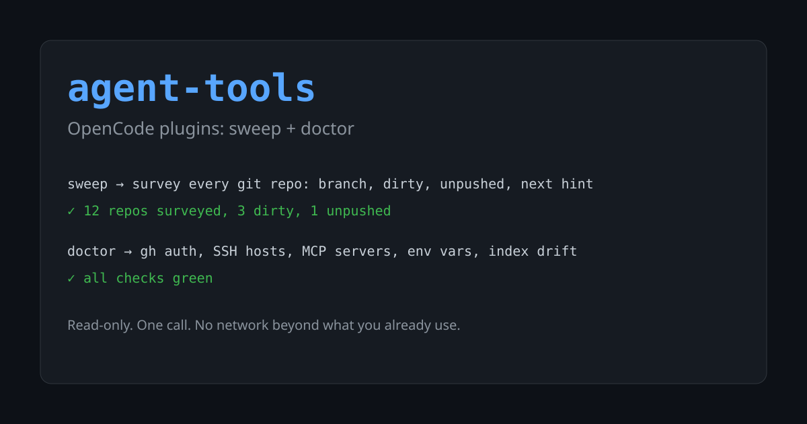

# agent-tools



OpenCode plugins for the things you would otherwise do by hand every session:
survey every repo at once, and check that the machine is wired up correctly.

Two tools, both read-only:

| Tool | What it does |
|---|---|
| `sweep` | One call that surveys every git repo under a root: branch, uncommitted files, unpushed commits, last commit date, line count, and a **next hint** mined from the repo's own docs. |
| `doctor` | Checks the machine: `gh` auth for every account, SSH to every host in `~/.ssh/config`, every MCP server reachable, every `{env:...}` var set, plugins readable, and index drift when a project index exists. |

## Why the next hint

`sweep` does not guess what to work on next. It reads the repo's own docs --
`README.md`, `AGENTS.md`, anything under a `docs/` folder -- and takes the
last `Phase N` / `Next` / `Roadmap` / `Stage N` heading, or the first
unchecked task if there is no such heading.

```
REPO               BRANCH  DIR  UNPUSH  LAST_COMMIT  LOC   NEXT_HINT
-----------------  ------  ---  ------  -----------  ----  ----------------
ahensi             main    0    0       2026-10-17   1727  -
ocvin              main    0    0       2026-10-08   784   Phase 3?
mintelfan          main    0    0       2026-09-29   546   Stage 8
c-playground       main    0    0       2026-09-22   0     Roadmap
02mmo              main    0    0       2026-09-16   666   next
game-dev-roadmap   main    0    1       2026-07-29   99    Game Dev Roadmap
```

`DIR` is uncommitted files, `UNPUSH` is commits not on the upstream (`-` when
there is no upstream), and the rows are sorted by last commit, newest first.

## Install

Requires [Bun](https://bun.sh) and OpenCode 2.x.

```sh
git clone git@github.com:farishan/agent-tools.git
cd agent-tools
./scripts/install.sh
```

The script symlinks the plugins into `~/.config/opencode/plugins/`, so
`git pull` updates the live copy. Existing files with the same name are
backed up rather than overwritten. To remove them again:

```sh
./scripts/install.sh --uninstall
```

### Permissions

`sweep` and `doctor` each have their own permission action. To stop them
asking on every call, add this to `~/.config/opencode/opencode.json`:

```json
"permissions": [
  { "action": "sweep",  "resource": "*", "effect": "allow" },
  { "action": "doctor", "resource": "*", "effect": "allow" }
]
```

Both tools are read-only, so allowing them outright is safe. `sweep` is
scoped to a single root per call, so you can also allow just one directory:

```json
{ "action": "sweep", "resource": "/Users/you/dev/personal", "effect": "allow" }
```

## Usage

In OpenCode, just ask:

> sweep my projects

> doctor -- is anything broken?

`doctor` takes an `offline` flag to skip the checks that reach the network
(SSH and MCP), and `sweep` takes a `root` and a `depth`.

## Layout

```
plugins/     the OpenCode plugin entries -- thin wrappers, one file per tool
src/         the actual logic, with no dependency on OpenCode
cli/         reserved for standalone command-line front-ends
test/        bun test
scripts/     install.sh, plus preview scripts for running the core directly
```

The split matters: `src/` has no OpenCode imports, so the same code can back
a standalone CLI later without being rewritten. See `cli/README.md`.

## Development

```sh
bun install       # only needed for tests and typecheck
bun test          # 31 tests, no network
bun run typecheck
bun scripts/sweep-preview.ts ~/dev/personal
bun scripts/doctor-preview.ts --offline
```

The preview scripts run the core directly, without OpenCode in the loop,
which makes them the fastest way to check a change.

Running the plugins does not need `bun install` -- OpenCode supplies
`@opencode/plugin` itself, so a plain clone works as soon as it is linked
into the plugin directory.

## Also included

`plugins/sh.ts` and `plugins/optmem.ts` are the original local plugins,
vendored here so this repo is the single source of truth for the whole
set. They are installed by the same script.

## License

MIT
